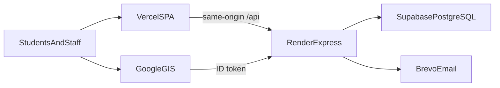
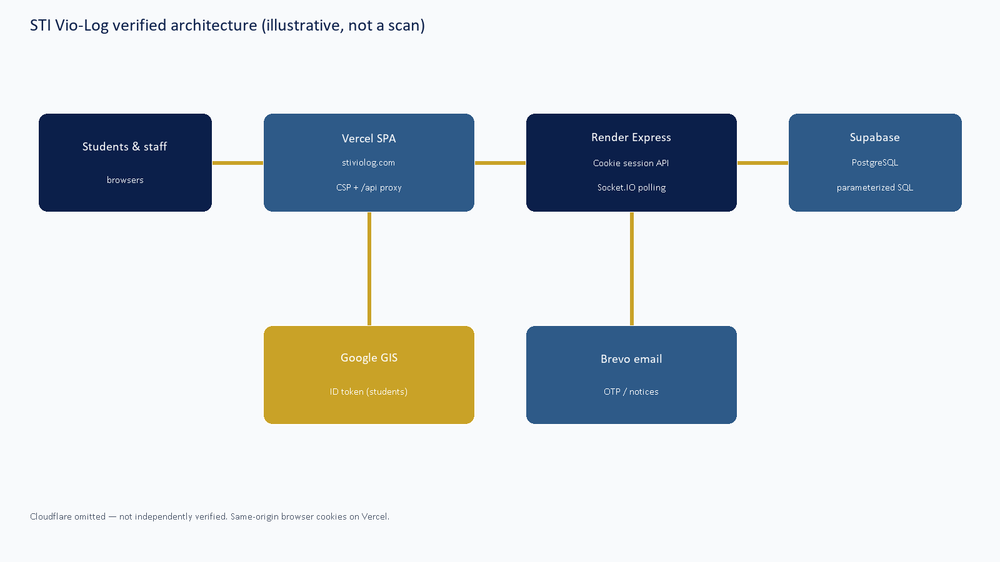
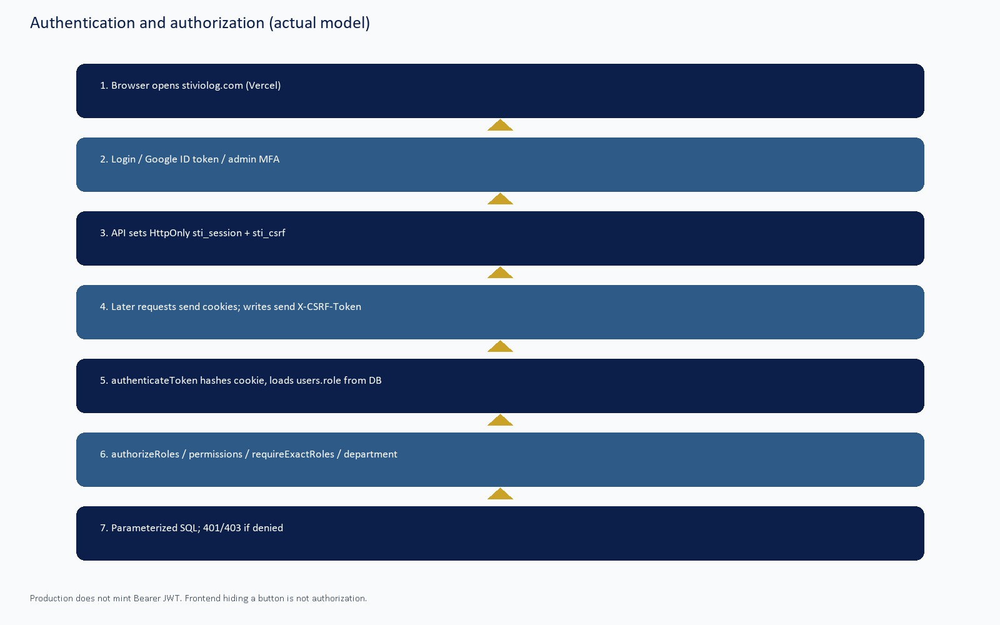

# STI VIO-LOG SECURITY ASSURANCE & CAPSTONE DEFENSE HANDBOOK

*Security Architecture, Implemented Protection Mechanisms, Vulnerability Assessment, Evidence Documentation, and Technical Defense Preparation*

---

## Document information

| Field | Value |
|---|---|
| Project | STI Vio-Log: A Web-Based Student Violation Monitoring and Incident Management System for STI Global City |
| Campus | STI Global City |
| Prepared for | STI Global City Capstone Defense |
| Prepared by | STI Vio-Log Development Team |
| Document version | 1.0 |
| Assessment date | 10 November 2026 |
| Source commit | `1255e0e` (`main`) |
| Companion audit | `docs/SECURITY_AUDIT_REPORT.md` |
| Assessment environment | Source review, local Node tests, public unauthenticated production smoke |
| Scope | Application source, in-repo migrations/CI, Vercel/Render configuration in git |
| Out of scope | Authenticated production probing, student production data, destructive load tests, Cloudflare DNS changes |
| Overall verdict | CONDITIONALLY READY |

This handbook is **not** an OWASP, NIST, or ISO certification. It is an evidence pack for capstone defense. Companion technical detail lives in `docs/SECURITY_AUDIT_REPORT.md`.

**Important correction for panelists.** Production authentication is **not** cookie JWT. Sessions are opaque `sti_session` cookies hashed in PostgreSQL. Bearer JWT issuance is disabled in production. Portal roles are `DISCIPLINE_ADMIN`, `DISCIPLINE_OFFICE`, `DEPARTMENT_HEAD`, and `STUDENT`. `ADMIN` and `SYSTEM_ADMIN` are not working portal roles. Cloudflare is **not** verified in front of the apex.

---

## 1. Executive security summary

STI Vio-Log is the Discipline Office portal for recording student violations, community-service attendance (QR time-in/out and digital DTR), clearance, certificates, and related messages. It stores student identifiers, academic placement, violation history, guardian contact for authorized staff, attendance, signatures, and staff account data. That information is personal and disciplinary. A leak or unauthorized edit can harm a student and the school.

**Why security matters here.** A student must not read another student’s violations. A department head must not scan attendance for another department’s assignment. An office account must not promote itself to administrator. Login pages must not be easy to brute-force. QR time-in must use the server clock, not the phone clock.

**What is implemented (source + tests).** Opaque HttpOnly session cookies; CSRF double-submit; per-request identity refresh from the database; bcrypt cost 12; hashed OTP with resend/attempt limits; Google Identity Services ID-token verify limited to linked students; RBAC permission catalog; department scoping; parameterized SQL; Helmet and Vercel CSP/HSTS; application rate limits; production config fail-closed; RLS enabled in migrations; CI workflow for Gitleaks, CodeQL, npm audit, and disposable Postgres.

**What attacks those controls address.** Stolen XSS cookies (HttpOnly), CSRF from other sites, SQL injection of `$n` queries, role confusion, many IDOR paths reviewed in source, OTP bombing (60s/5 tries), login spraying (10/15 min + throttle), clickjacking (frame deny), mixed-content (HTTPS/HSTS).

**What was tested on 10 November 2026.** Targeted backend tests: authentication middleware, account routes, legal policy, core RBAC, CSRF, rate limits, realtime security — **37/37 PASS**. `npm audit --omit=dev` reported no high-or-critical issues for backend and frontend production trees (as recorded in the audit). Public `GET /api/health` through https://stiviolog.com returned database connected after deploy `1255e0e`. That health check does **not** prove authorization.

**What was found and fixed.** Confirmed Medium C-01: some `/api/account` handlers lacked route-level role gates (controllers already 403). Confirmed Low C-02: a lab LAN IP was printed at API startup. Both were fixed in `1255e0e`. No confirmed Critical or High exploit was reproduced.

**What remains.** Live Supabase RLS/grants, exact `TRUST_PROXY_HOPS`, Vercel preview environment isolation, backup restore drills, Terms acknowledgment (`enforcementEnabled: false`), Cloudflare (absent/unverified), Render Free availability, Gitleaks not run on this Windows workstation.

**Overall assessment.** CONDITIONALLY READY. The source is production-shaped and reasonably hardened. It is not penetration-tested against live student data and not a school handover clearance until owner checks on NV items are recorded.

---

## 2. System overview

| Layer | Actual implementation |
|---|---|
| Users | Students and staff in a browser |
| Frontend | React 19 + Vite 8 on Vercel; canonical https://stiviolog.com |
| API proxy | Same-origin `/api/*` and `/socket.io/*` rewrites to Render (`frontend/vercel.mjs`) |
| Backend | Node.js Express + Socket.IO on Render (`https://sti-vio-log.onrender.com`) |
| Database | Supabase PostgreSQL via `pg`; no browser Supabase SDK |
| Email | Brevo HTTPS API (SMTP fallback is for local/dev; Render Free blocks SMTP ports) |
| Google | GIS ID token verified on the API |
| Auth | Opaque `sti_session` cookie; `sti_csrf` double-submit |
| Realtime | Socket.IO HTTP polling in production; cookie handshake; 15s reauthorization |

Frontend hiding a button is **not** security. The API must reject the request. This handbook always prefers backend evidence.

---

## 3. Security architecture

Cloudflare is **omitted** because it is not verified.

Authentication flow:

1. User opens https://stiviolog.com (Vercel).
2. Login (password, Google student, or admin MFA) hits `/api/...` on the same origin; Vercel proxies to Render.
3. On success the API sets `sti_session` (HttpOnly) and `sti_csrf` (readable by JS).
4. Later requests send cookies. Mutations also send `X-CSRF-Token`.
5. `authenticateToken` hashes the cookie and loads the **current** user row. Role and `session_version` come from the database, not from a client JWT.
6. `authorizeRoles` / `authorizePermissions` / `requireExactRoles` / department checks run.
7. Controllers use parameterized SQL. Unauthorized callers get 401/403. Denied authorization can be audited.

---

## 4. Security mechanisms

Status labels: **Implemented and verified** | **Implemented but not fully verified** | **Configuration required** | **Recommended but not implemented** | **Not implemented** | **Not applicable**.

### 4.A Authentication and account protection

#### Opaque session cookies (not production JWT)

1. **Mechanism.** Opaque `sti_session` cookie.
2. **Status.** Implemented and verified.
3. **Where.** `backend/src/services/browserSessionService.js`, `backend/src/middleware/authMiddleware.js`.
4. **How it works.** 32-byte random token; HMAC-SHA256 stored as `token_hash`; cookie HttpOnly, SameSite=Lax, Secure when `NODE_ENV=production`; 8 hour absolute expiry; idle 30 minutes for `DISCIPLINE_ADMIN`, 120 minutes otherwise.
5. **Threats.** Session fixation, token theft from JS, replay of expired sessions.
6. **Protects.** All portal users.
7. **Evidence.** SEC-001, SEC-002. Tests in `backend/tests/auth-middleware.test.js`.
8. **Attack example.** An attacker forges a cookie. The hash does not match `browser_sessions` → 401 generic failure.
9. **Limits.** A stolen live cookie works until idle/absolute expiry or logout revocation. XSS still matters; HttpOnly reduces cookie theft from scripts.

#### Legacy JWT helper

1. **Mechanism.** `jsonwebtoken` `issueSessionToken`.
2. **Status.** Not applicable in production (disabled). Implemented for constrained local/legacy tests only.
3. **Where.** `backend/src/services/sessionTokenService.js` lines 15–20.
4. **How.** Throws `Bearer session tokens are disabled in production.`
5. **Panel language.** “We do not authenticate production users with JWT. If you see JWT in package.json, it is leftover for local tests and is fail-closed in production.”

#### CSRF

1. **Mechanism.** Double-submit cookie plus header plus stored hash.
2. **Status.** Implemented and verified.
3. **Where.** `requireCsrf` in `authMiddleware.js` lines 136–146; `sti_csrf` is not HttpOnly so the SPA can copy it to `X-CSRF-Token`.
4. **Threats.** Cross-site POST using the victim’s cookies (SameSite=Lax already blocks many cases; CSRF is defense in depth).
5. **Evidence.** `backend/tests/csrf.test.js` (included in 37/37).

#### Password hashing

1. **Mechanism.** bcrypt cost 12.
2. **Status.** Implemented and verified in source.
3. **Where.** Student/staff account services and `studentController.js`.
4. **Threats.** Offline cracking of stolen hash dumps.
5. **Limits.** bcrypt does not stop phishing or reuse of a known password.

#### OTP

1. **Mechanism.** 6-digit codes, HMAC stored, 10 minute TTL, 5 attempts, 60 second resend, prior unused codes marked used.
2. **Status.** Implemented and verified in source/tests of OTP services.
3. **Where.** `backend/src/services/otpService.js`.
4. **Threats.** OTP bombing and guessing.
5. **Limits.** Email delay and mailbox compromise are outside the app.

#### Google student login

1. **Mechanism.** Google Identity Services ID token verified server-side; login joins `google_identity_links` **and** `students` with `role='STUDENT'`.
2. **Status.** Implemented and verified in source.
3. **Threats.** Staff Google accounts logging into the student portal; fake Google tokens.
4. **Limits.** Google Cloud authorized origins must stay correct (configuration required).

#### MFA (Discipline Administrator)

1. **Mechanism.** TOTP enroll/verify; hashed recovery codes, single use.
2. **Status.** Implemented in source (admin password login path).
3. **Threats.** Stolen admin password without the phone.

#### Logout / revocation

1. **Mechanism.** `revoked_at` on `browser_sessions`; sockets disconnected.
2. **Status.** Implemented and verified in source/tests (realtime disconnect on invalid session).
3. **Limits.** A copy of the cookie still works until revocation or expiry. There is no sliding public JWT to “wait out.”

### 4.B Authorization and access control

| Role | Meaning | Notable permissions |
|---|---|---|
| DISCIPLINE_ADMIN | Discipline Office administrator | Operational + staff admin + technical (lock, security events, MFA) |
| DISCIPLINE_OFFICE | Office staff | Students, violations, attendance, clearance, messages; not staff-account or system lock |
| DEPARTMENT_HEAD | Department officer | Basic student view, scan/invalidate attendance, department reports; no private-message permission; no violation create |
| STUDENT | Enrolled student | Own records + private messages |

Hiding UI in `frontend/src/lib/routes.js` is convenience. Enforcement is `authorizeRoles`, `authorizePermissions`, `requireExactRoles`, and object checks (student `req.user.id`, department `department_id`, message `assertConversation`).

**Student-to-student.** Student “me” routes bind to `req.user.id`. Extra `student_id` query fields are rejected (`assertAllowedFields`) — observed in core RBAC tests. Students lack `VIOLATION_*` permissions.

**Department.** Heads need an assigned `department_id`. QR and DTR force that department. Community-service day invalidation re-checks assignment department.

**C-01 (fixed).** Onboarding and admin-profile routes now use `requireExactRoles` so a staff token cannot even enter student onboarding handlers.

### 4.C API and input security

- Parameterized SQL (`$1`, `$2`) in reviewed controllers.
- `assertAllowedFields` rejects unexpected JSON/query keys.
- Default JSON body 128 KB; larger only on signature/avatar routes.
- HTTP request timeout 30s; statement_timeout 15s.
- CORS allowlist from `FRONTEND_URL`; production excludes localhost.
- Helmet on Express; Vercel headers (HSTS, nosniff, DENY framing, CSP).
- Generic 500 messages to clients (`utils/api.js`). Host logs may still contain stacks (limitation).
- No `dangerouslySetInnerHTML` in frontend source (audit).
- CSRF as above.

### 4.D Database and data security

- App uses `pg` with a runtime role; migrations enable RLS and grant `sti_vio_log_runtime`.
- Live console (forced RLS, Data API off, `NOBYPASSRLS`) is **configuration required / not fully verified**.
- Production `DB_SSL` must not be `disable` or `no-verify`.
- Service-role / database passwords are not `VITE_*` and must not be in the SPA.
- Backups: scripts exist (`backend/scripts/backup.js`); restore drill **not verified**.

### 4.E Attack prevention and availability

| Control | Layer | Status |
|---|---|---|
| 200 requests / 15 min / IP | Application | Implemented and verified (unit tests) |
| 600 GET / 15 min / account | Application | Implemented and verified |
| 10 / 15 min sensitive auth + throttle service | Application | Implemented and verified |
| OTP 60s / 5 tries | Application | Implemented and verified in source |
| Request size and timeouts | Application | Implemented |
| Vercel/Render platform DDoS | Infrastructure | Implemented but not fully verified (provider default) |
| Cloudflare WAF / bot | Infrastructure | Not implemented (not in repo) |
| Dedicated load balancer product | Infrastructure | Not applicable as a custom control; Vercel/Render terminate TLS and scale their own edge |
| Render Free single instance | Availability | Residual: floods can still exhaust the process |

Application rate limiting is **not** a WAF and **not** DDoS insurance.

### 4.F Frontend and browser security

- Production API URL is same-origin so cookies stay first-party on `stiviolog.com`.
- CSP allows Google GSI scripts/frames only as listed in `vercel.mjs`.
- `Permissions-Policy`: camera=(self) for QR, microphone/geo empty.
- Display user may be cached in `localStorage`; the session token is **not**.
- HTTPS and HSTS on Vercel; API `enforceHttps` in production.

### 4.G Infrastructure

| Provider | Developer-owned | Provider-owned / unverified |
|---|---|---|
| Vercel | `vercel.mjs` CSP/proxy, SPA code | Deployment Protection, preview env scoping, platform DDoS |
| Render | Express bind, Helmet, CORS, health path | `TRUST_PROXY_HOPS` correctness, log retention, Free spin-down |
| Supabase | Migrations, parameterized queries | Live RLS, Data API, PITR |
| GitHub | SHA-pinned Actions, ignore-scripts ci | Org secret scanning, branch protection |
| Cloudflare | None | Not configured in evidence |

### 4.H Email and third parties

- Brevo API key is a server env var, not `VITE_*`.
- OTP send is rate-limited in `otpService`.
- No inbound Brevo webhook handler was treated as a public unsigned control in this review.
- Google client ID in the frontend is **public by design**; the secret is the ID-token verification on the server.

### 4.I Application-specific records

| Record | Who can change | Binding |
|---|---|---|
| Violations | Office/admin permissions | Students have no write permission |
| Community service / DTR | Scan and invalidate permissions; heads scoped | Assignment `department_id` |
| QR time-in/out | `ATTENDANCE_SCAN` | Server `clock_timestamp()`; assignment list scoped |
| Clearance / e-signature | Clearance and ESIGNATURE permissions; image magic-byte parsers | Not a PKI digital signature |
| Certificates | Issue permission; public verify by HMAC code | Extra 30/15 min limiter; masked student number |
| Messages | `PRIVATE_MESSAGES_VIEW`; students own `student_id` | Heads have no message permission |
| Audit / high-risk | Admin permissions + step-up where coded | Not a SIEM |

---

## 5. Attack prevention and defense matrix

| Attack | What the attacker tries to do | Security mechanism | How STI Vio-Log responds | Verification evidence |
|---|---|---|---|---|
| SQL injection | Put SQL in a field | Parameterized queries | Driver sends values separately | Source review; RBAC tests reject extra fields |
| XSS | Run script in another user’s browser | React text rendering; CSP; HttpOnly session | Script should not read `sti_session`; CSP limits script sources | No `dangerouslySetInnerHTML`; CSP in `vercel.mjs` |
| CSRF | Other site posts with victim cookies | SameSite=Lax + CSRF cookie/header/hash | 403 `CSRF_INVALID` | csrf tests PASS |
| Brute-force login | Guess passwords | 10/15 min limiter + throttle + generic error | 429 / slow-down; no username oracle | rate-limit tests PASS |
| Credential stuffing | Reuse leaked passwords | Same plus bcrypt; MFA for admin | Limits attempts; MFA blocks password-only admin login | Source; stuffing volume NOT TESTED |
| JWT manipulation | Edit a Bearer JWT | Production does not issue Bearer JWT | `issueSessionToken` throws in production | SEC-003 |
| Session hijacking | Steal `sti_session` | HttpOnly, Secure, HTTPS, idle expiry, logout revoke | Stolen cookie works until expiry/revoke | Source; live theft NOT TESTED |
| Unauthorized API access | Call Render URL without UI | Authn middleware | 401 without cookie | core-rbac + auth tests |
| IDOR | Change another student’s id | Ownership and `assertAllowedFields` | 403/400 | core-rbac PASS |
| BOLA | Same as IDOR on objects | Message/notification/DTR scoping | Denied or scoped | Source + RBAC tests |
| BFLA | Call admin function as student | Permissions + `requireExactRoles` | 403 | C-01 fixed; account-api tests |
| Privilege escalation | Send `role=ADMIN` in JSON | Role comes from DB | Ignored | authenticateToken SQL |
| Student-to-student access | Open `/api/students/:other` | No student manage permission; me-routes use self | 403/400 | core-rbac |
| API abuse | Flood GETs | 200/15m and 600/15m | 429 | rate-limits PASS |
| OTP bombing | Request many emails | 60s resend | 429 `OTP_RESEND_LIMITED` | otpService source |
| DoS | Exhaust the Node process | Timeouts, body limits, rate limits | Slows attacker; Free instance can still fall over | Gap: availability |
| DDoS | Many networks flood | Provider defaults only | No Cloudflare claim | Not implemented as a project WAF |
| Malicious uploads | Upload HTML/polyglot as signature | Magic bytes, size, dimensions | Reject non PNG/JPEG structure | NV-02 residual: not full re-encode |
| QR manipulation | Fake QR payload | Opaque server-issued QR; assignment binding | Invalid assignment/token fails | Source; replay NOT TESTED in production |
| Attendance manipulation | Client clock / wrong department | `clock_timestamp()`; department gate | Server time; 403 | qrController + middleware |
| DB credential leakage | Steal `.env` | gitignore; examples only | Keys not in SPA | gitignore; Gitleaks local NOT TESTED |
| Exposed env in frontend | Put DB URL in `VITE_*` | Only public Google client id | No service role in frontend | source |
| Sensitive disclosure | 500 stack to browser | Generic API errors | Client sees generic message | Host logs may still stack |
| Unauthorized clearance | Student approves self | CLEARANCE_APPROVE permission | 403 | permission catalog |
| Unauthorized e-signature change | Swap another officer’s image | ESIGNATURE_MANAGE + parsers | 403 / invalid file | Source |

---

## 6. Security evidence

Verification date for this catalog: **10 November 2026**. Secrets and student data are omitted.

### SEC-001 — Opaque cookie authentication

- **Source.** `backend/src/middleware/authMiddleware.js` lines 32–80.
- **Proves.** Missing cookie → 401. Present cookie is hashed and joined to `users` with expiry/revocation checks. Role is selected from the database.
- **Does not prove.** Production cookie flags as observed in a browser DevTools capture (inferred from source: Secure when NODE_ENV=production).

### SEC-002 — Cookie flags and hashed storage

- **Source.** `backend/src/services/browserSessionService.js` lines 7–44.
- **Proves.** HttpOnly session; CSRF cookie readable; HMAC storage; idle/absolute expiry.
- **Does not prove.** Exact production `SESSION_HASH_KEY` entropy (must exist per `validateSecureConfig`).

### SEC-003 — Bearer JWT disabled in production

- **Source.** `backend/src/services/sessionTokenService.js` lines 15–20.
- **Proves.** Production cannot mint Bearer JWT sessions.
- **Does not prove.** That `jsonwebtoken` is unused in development tests.

### SEC-004 — CSRF validation

- **Source.** `authMiddleware.js` lines 136–146.
- **Proves.** Mutations need cookie = header and HMAC match.
- **Does not prove.** Every SPA screen sends the header (frontend `api.js` is the shared client).

### SEC-005 — Four-role permission catalog

- **Source.** `backend/src/security/permissions.js` lines 66–71.
- **Proves.** STUDENT cannot create violations; DEPARTMENT_HEAD cannot message; DISCIPLINE_OFFICE cannot lock accounts.

### SEC-006 — Route-level account gates (C-01 fix)

- **Source.** `backend/src/routes/accountRoutes.js` lines 5–18; `requireExactRoles` lines 204–211 of `authMiddleware.js`.
- **Proves.** Onboarding is STUDENT-only; admin profile is DISCIPLINE_ADMIN-only at the router.

### SEC-007 — SYSTEM_ADMIN is not a portal

- **Source.** `frontend/tests/routes.test.js` (`getHomePath('SYSTEM_ADMIN') === '/unauthorized'`).
- **Proves.** Do not tell the panel “we have a SYSTEM_ADMIN dashboard.”

### SEC-008 — bcrypt cost 12

- **Source.** `studentController.js` and account services.
- **Proves.** New passwords are not stored reversible.

### SEC-009 — OTP hashing and limits

- **Source.** `otpService.js` lines 4–38.
- **Proves.** Codes are not stored in plaintext; resend and attempts are bounded.

### SEC-010 — Rate limiters

- **Source.** `rateLimiters.js`; tests `backend/tests/rate-limits.test.js`.
- **Proves.** Application-layer budgets exist and are unit-tested.
- **Does not prove.** Survival of a volumetric DDoS.

### SEC-011 — Vercel headers and preview isolation in source

- **Source.** `frontend/vercel.mjs` lines 8–36.
- **Proves.** CSP/HSTS/frame deny; non-production must not proxy to production API origin.
- **Does not prove.** Preview env vars in the Vercel dashboard (NV-05).

### SEC-012 — Production fail-closed config

- **Source.** `backend/src/config/security.js` lines 7–32.
- **Proves.** Weak secrets, missing hops, disable SSL are rejected at boot in production.

### SEC-013 — RLS in migrations

- **Source.** `database/migrations/034_session_mfa_hardening.sql` and later table migrations.
- **Proves.** Source intends RLS + runtime role.
- **Does not prove.** Live Supabase console (NV-04).

### SEC-014 — QR server clock

- **Source.** `qrController.js` line 37.
- **Proves.** Time-in uses database `clock_timestamp()`.

### SEC-015 — GitHub security workflow

- **Source.** `.github/workflows/security.yml`.
- **Proves.** CI defines Gitleaks, CodeQL, npm audit, disposable DB gate.
- **Does not prove.** This workstation ran Gitleaks (it did not).

### SEC-016 — Remediation retest

- **Source.** `docs/SECURITY_AUDIT_REPORT.md` section J; Node test run 10 Nov 2026.
- **Proves.** 37/37 targeted tests PASS after C-01/C-02.

**Evidence index.** Claims in sections 4–5 map to SEC-001–016 and to the companion audit. Missing ZAP/Trivy/OSV/Semgrep runs are listed as NOT TESTED, not as PASS.

---

## 7. Security testing results

**Environment.** Developer Windows workstation; Node 24; backend `node --test` with local gitignored `.env` loaded by tests (values not copied here). Date: 10 November 2026. Method: automated unit/integration unless noted.

| Test ID | Test scenario | Expected behavior | Actual result | Status | Evidence |
|---|---|---|---|---|---|
| T-AUTH-01 | Missing session cookie | 401 | 401 | PASS | auth-middleware.test.js |
| T-AUTH-02 | Valid opaque cookie | Identity from DB | Accepted | PASS | auth-middleware.test.js |
| T-AUTH-03 | Expired/revoked session | Reject | Rejected | PASS | auth-middleware.test.js |
| T-AUTH-04 | Forged cookie | Generic reject | Generic reject | PASS | auth-middleware.test.js |
| T-AUTH-05 | Unverified student | Protected APIs deny | Deny | PASS | auth-middleware.test.js |
| T-AUTH-06 | Forced password change vs role gates | 403 PASSWORD_CHANGE_REQUIRED | 403 | PASS | auth-middleware.test.js |
| T-AUTH-07 | Onboarding student vs authorizeRoles | 403 STUDENT_ONBOARDING_REQUIRED | 403 | PASS | auth-middleware.test.js |
| T-AUTH-08 | requireExactRoles student vs office | Allow student; 403 office | As expected | PASS | auth-middleware.test.js |
| T-AUTH-09 | Legacy Bearer in production | Disabled | Disabled | PASS | account-api.test.js |
| T-RBAC-01 | Mounted API role/ownership | Students cannot write violations; extra fields rejected; CORS deny | Enforced | PASS | core-rbac.integration.test.js |
| T-CSRF-01 | CSRF on mutations | Invalid token 403; GET exempt | Enforced | PASS | csrf tests in 37-set |
| T-RATE-01 | Account GET budget 600/15m | Shared per user id | Enforced | PASS | rate-limits.test.js |
| T-RATE-02 | Failed reads 200/IP | Forged sessions share failed bucket | Enforced | PASS | rate-limits.test.js |
| T-RATE-03 | Auth 10 attempts | Shared ten-attempt limit | Enforced | PASS | rate-limits.test.js |
| T-RT-01 | Socket rooms isolate user/role/dept | No cross-room | Isolated | PASS | realtime-security.test.js |
| T-RT-02 | Revoked session disconnects | Forced disconnect | Disconnect logged | PASS | realtime-security.test.js |
| T-LEGAL-01 | enforcementEnabled false | No required ack | Disabled as designed | PASS | legal-policy.test.js |
| T-DEP-01 | npm audit --omit=dev | No high+ | 0 high+ recorded in audit | PASS | SECURITY_AUDIT_REPORT |
| T-HEALTH-01 | Public GET /api/health via apex | DB connected | connected | PASS | vercel curl after 1255e0e |
| T-GITLEAKS-01 | Full-history Gitleaks on this PC | N/A | Binary not installed | NOT TESTED | SEC-015 |
| T-ZAP-01 | OWASP ZAP | N/A | Not run | NOT TESTED | — |
| T-RLS-LIVE | Production RLS console | Forced RLS | Not accessed | NOT TESTED | NV-04 |
| T-PGTEST | backend *.pgtest.js | Pass on disposable DB | Skipped (avoid prod DATABASE_URL) | NOT TESTED | audit limits |
| T-DDOS-01 | Flood Render | Stay up | Not run (destructive) | NOT TESTED | — |

---

## 8. Vulnerability assessment

| ID | Severity | Status | Summary |
|---|---|---|---|
| C-01 | Medium | Fixed in `1255e0e` | Account routes lacked router role gates |
| C-02 | Low | Fixed in `1255e0e` | LAN IP in listen logs |
| NV-01 | — | Largely addressed in source | Socket reauth 15s; live production tab not watched |
| NV-02 | — | Residual | Image magic bytes exist; full pixel re-encode unverified |
| NV-03 | — | Configuration required | `TRUST_PROXY_HOPS` must match Vercel→Render hops |
| NV-04 | — | Configuration required | Live RLS / Data API / runtime grants |
| NV-05 | — | Configuration required | Preview `API_PROXY_ORIGIN` in Vercel dashboard |
| NV-06 | — | Configuration required | Backup restore drill |
| NV-07 | — | Not implemented | Cloudflare |
| NV-08 | — | Gap by design | Terms `enforcementEnabled: false` |
| NV-09 | — | Residual | Render Free cold start / single instance |
| NV-10 | — | Configuration required | Protect local `.env`; rotate if ever shared |

No confirmed Critical/High open item in source plus local tests.

---

## 9. Security limitations and recommendations

Prioritized:

1. **High operational.** Confirm live Supabase RLS, no anon CRUD, runtime `NOSUPERUSER NOBYPASSRLS`, TLS verify (NV-04).
2. **High operational.** Measure `TRUST_PROXY_HOPS` (NV-03) so rate-limit IPs are real client IPs.
3. **High operational.** Confirm Vercel preview does not proxy production API (NV-05). Dashboard only.
4. **Medium.** Encrypted backup restore drill (NV-06).
5. **Medium.** Optional Cloudflare proxy for WAF/DDoS — **owner DNS change**, not claimed today.
6. **Medium.** Render plan upgrade if concurrent QR + polling saturates Free (NV-09).
7. **Medium.** Decide with the school whether to enable Terms acknowledgment (NV-08).
8. **Low.** Image re-encode/sanitize (NV-02).
9. **Low.** Reduce stack traces in Render logs; SIEM/alerting beyond `recordSecurityEvent`.
10. **Process.** Annual review; rotate keys if leaked; do not treat this handbook as a pentest report.

Incident sketch (not a full IR playbook): revoke sessions (`session_version` / `revokeUserSessions`), rotate secrets, inspect audit_events, restore from backup if integrity is lost.

---

## 10. Capstone defense question bank

Answers are written for a spoken defense. Technical notes are for follow-up. They match **this repository**, not a generic JWT tutorial.

### Group A — General system security

**Q1. What is cybersecurity?**  
Spoken: Cybersecurity is protecting our system and student data from people who should not see or change them.  
Technical: Confidentiality, integrity, availability plus authentication and authorization.  
Follow-up: Is antivirus enough?  
Follow-up answer: No. We also need login sessions, role checks, SQL safety, and HTTPS.

**Q2. Why is security important in STI Vio-Log?**  
Spoken: We store violations, attendance, and personal student data. A leak can embarrass a student and the Discipline Office.  
Technical: Disciplinary records are sensitive personal data.  
Follow-up: What is the worst case?  
Follow-up answer: Another student reads violations, or someone forges clearance.

**Q3. What sensitive information does the system protect?**  
Spoken: Names, student numbers, programs, violations, DTR, guardian contacts for staff, signatures, and accounts.  
Technical: See students, violations, community_service_*, clearance, browser_sessions.  
Follow-up: Do we store card PANs?  
Follow-up answer: No payment cards. Not applicable.

**Q4. What security measures have you implemented?**  
Spoken: Secure cookies, CSRF, roles, hashed passwords, OTP limits, Google for students only, rate limits, SQL parameters, HTTPS headers, and database RLS in migrations.  
Technical: See section 4 and SEC-001–016.  
Follow-up: Is that a WAF?  
Follow-up answer: No. Rate limits are in Express. Cloudflare is not configured.

**Q5. How did you evaluate security?**  
Spoken: We reviewed the real code, ran Node security tests, checked npm audit, and used a written audit report. We did not hack live student accounts.  
Technical: 37/37 targeted tests 10 Nov 2026; companion `SECURITY_AUDIT_REPORT.md`.  
Follow-up: Why no ZAP?  
Follow-up answer: ZAP was not run this pass. We mark it NOT TESTED, not PASS.

**Q6. What standards did you follow?**  
Spoken: We used OWASP Top 10 and API Top 10 as checklists, not as a certificate.  
Technical: Also ASVS session guidance and CWE IDs in the audit.  
Follow-up: Are you OWASP certified?  
Follow-up answer: No.

**Q7. Is your system completely secure?**  
Spoken: No system is 100% secure. Ours is reasonably hardened in code. Live database settings and DDoS still need owner checks.  
Technical: Verdict CONDITIONALLY READY.  
Follow-up: Then why deploy?  
Follow-up answer: Controls in source are real; remaining items are operational, not a known Critical exploit.

**Q8. What is the biggest security risk?**  
Spoken: Either a stolen staff session, or production database grants that we did not re-open in the dashboard this week, or traffic knocking down the Free API.  
Technical: NV-04, session hijack residual, NV-09.  
Follow-up: Insider threat?  
Follow-up answer: An office user with VIOLATION_CREATE can file records. That is authorized power. We log security events; we do not stop a malicious insider with valid rights.

### Group B — Authentication and account security

**Q9. What authentication method does your system use?**  
Spoken: After login, the browser keeps an HttpOnly cookie named sti_session. It is a random secret, not a JWT in production.  
Technical: HMAC stored in browser_sessions; authenticateToken loads the user.  
Follow-up: Why do people say JWT?  
Follow-up answer: Early docs and jsonwebtoken remain. Production `issueSessionToken` throws.

**Q10. What is JWT?**  
Spoken: A JWT is a signed string with data inside, like user id and role.  
Technical: HS256 library exists but is disabled in production.  
Follow-up: Why not JWT then?  
Follow-up answer: We want revocation in the database and we do not want the client to carry a role claim.

**Q11. Why did you not use cookie JWT in production?**  
Spoken: If the role is inside the token, people think they can edit it. We store a random id and look up the real role every request.  
Technical: Opaque token + server hash.  
Follow-up: Can you still expire sessions?  
Follow-up answer: Yes. idle_expires_at, absolute 8h, revoked_at.

**Q12. How does the system verify a user is authenticated?**  
Spoken: The API reads the cookie, hashes it, and checks an unrevoked row that is still inside idle and absolute time, with an active user.  
Technical: SQL in authenticateToken.  
Follow-up: What if the cookie is missing?  
Follow-up answer: 401 Authenticated session required.

**Q13. How do you protect authentication cookies?**  
Spoken: HttpOnly so JavaScript cannot read sti_session. Secure on HTTPS in production. SameSite Lax. Path /.  
Technical: cookieOptions in browserSessionService.js.  
Follow-up: Why is CSRF cookie not HttpOnly?  
Follow-up answer: The SPA must copy it to X-CSRF-Token. The session cookie stays HttpOnly.

**Q14. What is HttpOnly?**  
Spoken: The browser will not give that cookie to document.cookie.  
Technical: Mitigates XSS cookie theft, not XSS itself.

**Q15. What are Secure and SameSite?**  
Spoken: Secure means HTTPS only in production. SameSite Lax means other sites cannot easily POST our cookie on most browsers.  
Technical: CSRF still enforced.

**Q16. How does Google login work?**  
Spoken: The student signs in with Google. The backend verifies the Google ID token. Login only succeeds if that Google account is linked to a STUDENT row. Staff cannot sneak in through Google login.  
Technical: googleIdentityService + students join.  
Follow-up: PKCE?  
Follow-up answer: Not a redirect OAuth code flow. It is GIS ID-token verify.

**Q17. How do you protect against brute-force?**  
Spoken: Login routes share a ten-try window plus a throttle service, and errors do not say whether the username exists.  
Technical: rate-limits tests; generic Invalid username or password.  
Follow-up: Captcha?  
Follow-up answer: Not implemented. Optional future (Turnstile) would need Cloudflare or similar.

**Q18. How does OTP work?**  
Spoken: We email a six-digit code. We store a hash, not the code. It dies in ten minutes, five guesses, and you wait sixty seconds to resend.  
Technical: otpService.js.  
Follow-up: Can I read OTP from logs?  
Follow-up answer: Codes must not be logged. We store otp_hash.

**Q19. What happens when a session expires?**  
Spoken: The next API call returns 401 and the SPA sends the user to login.  
Technical: idle or absolute timestamp in SQL.  
Follow-up: Silent refresh JWT?  
Follow-up answer: No refresh JWT. User logs in again. Admin idle is 30 minutes.

**Q20. How does logout work?**  
Spoken: Logout sets revoked_at on that session, clears cookies, and drops Socket.IO connections.  
Technical: revokeFromRequest.  
Follow-up: Other devices?  
Follow-up answer: revokeUserSessions can revoke all rows for the user when that path is used (password change / lock).

### Group C — Authorization and user roles

**Q21. What is RBAC?**  
Spoken: Each account has one role, and each role has a fixed list of permissions in code.  
Technical: permissions.js ROLE_PERMISSIONS.

**Q22. How do you distinguish students from administrators?**  
Spoken: The role column on users. The home page is different, but the API also checks the role. There is no ADMIN role. The administrator is DISCIPLINE_ADMIN.  
Technical: getHomePath; authorizeRoles.

**Q23. How do you stop a student viewing another student’s records?**  
Spoken: Student APIs use the logged-in id, not an id the student types. Extra student_id fields are rejected. They also lack staff permissions.  
Technical: core-rbac tests.

**Q24. Can a student modify violation records?**  
Spoken: No. Violation write permissions are not on STUDENT.  
Technical: VIOLATION_CREATE etc. only office/admin.

**Q25. Can users change their own role?**  
Spoken: Not through a normal profile field. Role is in the database and is not taken from JSON the way a name is.  
Technical: Mass-assignment protections; admin staff-manage is a privileged permission.

**Q26. How does the backend verify permissions?**  
Spoken: Middleware loads permissions for the role and compares them to the route.  
Technical: authorizePermissions.

**Q27. What if someone edits an API request in DevTools?**  
Spoken: They can change the JSON. The server still checks the cookie’s user and permissions. Changing role in the body does not make them admin.  
Technical: Identity from browser_sessions join users.

**Q28. What is privilege escalation?**  
Spoken: Becoming a more powerful role than assigned. We block it by storing role in the database and gating routes.  
Technical: C-01 added router gates so even unused URLs 403.

**Q29. What is IDOR?**  
Spoken: Insecure Direct Object Reference — changing an id in the URL to open someone else’s record.  
Technical: We bind student me-routes and message conversations.

**Q30. What is BOLA?**  
Spoken: Broken Object Level Authorization, the API name for IDOR.  
Technical: Same controls; heads are object-scoped by department.

### Group D — Database and API security

**Q31. How do you protect PostgreSQL?**  
Spoken: The API uses a runtime database user, TLS is required in production config, queries use parameters, and migrations turn on RLS.  
Technical: security.js DB_SSL; NV-04 live console.

**Q32. What is Row Level Security?**  
Spoken: Postgres policies that filter rows even if SQL is broad.  
Technical: ENABLE ROW LEVEL SECURITY in migrations.

**Q33. How does Supabase RLS work here?**  
Spoken: We do not put the anon key in the browser. The Node server talks with pg. RLS is still defense in depth if a role is mis-granted.  
Technical: Live policies need dashboard confirmation.

**Q34. What is SQL injection?**  
Spoken: Putting SQL in a text field hoping the database will run it.  
Technical: We use $1 placeholders.

**Q35. How do you prevent SQL injection?**  
Spoken: Parameterized queries. We also reject unexpected field names.  
Technical: assertAllowedFields.

**Q36. How do you validate inputs?**  
Spoken: Types, allowed fields, file magic bytes, CSRF, size limits.  
Technical: validators.js.

**Q37. What is CORS?**  
Spoken: Which websites may call our API from a browser. Production only allows listed HTTPS frontends.  
Technical: allowedOriginsFor; localhost not in production.

**Q38. What is XSS?**  
Spoken: Injecting JavaScript into a page. We render with React text, set CSP, and keep the session cookie HttpOnly.  
Technical: No dangerouslySetInnerHTML found.

**Q39. What is CSRF?**  
Spoken: A trick site submitting a form as the logged-in user. We require a CSRF token that the other site cannot read.  
Technical: requireCsrf.

**Q40. Why must service-role keys stay off the frontend?**  
Spoken: A service role bypasses RLS. If it is in JavaScript, anyone can copy it. Our SPA has no Supabase service key.  
Technical: VITE_* is only public Google client id / local API URL.

### Group E — Infrastructure and network

**Q41. How is the system protected from DDoS?**  
Spoken: Vercel and Render have platform protections. We did not add Cloudflare. Application rate limits only slow one IP or account. A large DDoS can still hurt a Free Render instance.  
Technical: Do not claim WAF.

**Q42. Difference between DoS and DDoS?**  
Spoken: DoS is one source. DDoS is many sources together.

**Q43. What is rate limiting?**  
Spoken: Caps how many requests you may send in fifteen minutes.  
Technical: 200 IP, 600 account GET, 10 login.

**Q44. Do you have a load balancer?**  
Spoken: We did not build a custom load balancer. Vercel’s CDN and Render’s proxy terminate HTTPS. One Render Free instance serves the API.  
Technical: Not applicable as a product we configured.

**Q45. What is a WAF?**  
Spoken: A Web Application Firewall in front of the site. We do not have a project Cloudflare WAF.  
Technical: Recommended but not implemented.

**Q46. What is Cloudflare used for?**  
Spoken: In many schools, DNS and DDoS. For us, evidence shows GoDaddy to Vercel. We do not claim Cloudflare is on.  
Technical: NV-07.

**Q47. What do Vercel and Render provide?**  
Spoken: Vercel hosts the UI, HTTPS, headers, and same-origin proxy. Render runs Node, health checks, and env secrets.  
Technical: Developer vs provider split in section 4.G.

**Q48. How do you secure production?**  
Spoken: HTTPS origins, fail-closed secrets, no Bearer JWT, proxy isolation in vercel.mjs, health checks.  
Technical: Deploy 1255e0e live on Render; Vercel alias stiviolog.com.

**Q49. How are environment variables protected?**  
Spoken: Real keys live in Render/Vercel dashboards. Git only has .env.example. .gitignore ignores .env.  
Technical: Do not print values.

**Q50. How do you detect exposed secrets?**  
Spoken: GitHub Actions can run Gitleaks. We did not run Gitleaks on this PC this week, so we do not fake a scan report.  
Technical: NOT TESTED locally; workflow exists.

### Group F — Data privacy and integrity

**Q51. How do you protect student information?**  
Spoken: Login, roles, HTTPS, hashed passwords, no student write on violations.  
Technical: RBAC + TLS config.

**Q52. Unauthorized violation history?**  
Spoken: Students only hit self routes; staff need view permissions.  
Technical: T-RBAC-01.

**Q53. QR attendance security?**  
Spoken: The QR is an opaque value from the server. Scanning requires ATTENDANCE_SCAN. Heads only see their department assignments. Time comes from the database clock.  
Technical: SEC-014.

**Q54. Attendance manipulation?**  
Spoken: You cannot set yesterday on the phone and have the server trust it. Invalidation is a permission and is department-checked.  
Technical: communityServiceSessionService + requireAuthorizedDepartment.

**Q55. Community service records?**  
Spoken: Assignments belong to a department. Heads cannot manage another department’s assignment.  
Technical: Source review in audit.

**Q56. E-signatures and clearance?**  
Spoken: Only roles with clearance and signature permissions. Images must look like PNG or JPEG. Certificates use an HMAC verification code, not a government digital signature.  
Technical: Honest: electronic image signing, not PKI.

**Q57. Sensitive data in logs?**  
Spoken: We try not to log passwords or OTP. API errors to the browser are generic. Render logs may still have stack traces, so logs must stay private.  
Technical: Limitation.

**Q58. Suspicious activity?**  
Spoken: AUTHORIZATION_DENIED can be recorded as a security event for admins with SECURITY_EVENTS_VIEW. This is not a 24/7 SOC.  
Technical: recordSecurityEvent.

### Group G — Testing, maintenance, advanced

**Q59. What security testing tools did you use?**  
Spoken: Node’s test runner, npm audit, code review, and GitHub’s security workflow definition. Not ZAP, not Burp, not Trivy on this pass.  
Technical: Table in section 7.

**Q60. What is the OWASP Top 10?**  
Spoken: A list of common web risks like injection, broken access control, and XSS. We mapped our controls to it. We are not certified.

**Q61. Vulnerability scanning vs penetration testing?**  
Spoken: Scanning looks for known issues in code and libraries. Pentest is a person trying to break in. We did a source-and-local assessment, not a live pentest of student data.

**Q62. Vulnerable dependencies?**  
Spoken: npm audit --omit=dev on 10 Nov 2026 showed no high or critical in production trees, as recorded in the audit. That number can change next week.

**Q63. If an API key leaks?**  
Spoken: Rotate it in Render/Brevo/Google, revoke sessions, check git history, and watch audit logs. Do not commit a new key.

**Q64. If the database is compromised?**  
Spoken: Assume records can be read. Restore from backup after rotating credentials. That is why NV-06 matters. RLS is extra, not magic if the attacker is superuser.

**Q65. Recover from an incident?**  
Spoken: Take the API to maintenance if needed, rotate secrets, revoke sessions, restore data, tell the Discipline Office, then write what happened.

**Q66. How often to review security?**  
Spoken: After major features, and at least every term. Dependencies more often.

**Q67. Future improvements?**  
Spoken: Confirm live RLS, hops, preview env, backups, maybe Cloudflare, maybe Terms enforcement, maybe a paid Render instance.

**Q68. How do you know controls work?**  
Spoken: Automated tests that fail when someone removes a check, plus code review. Health checks do not prove RBAC.

**Q69. What is DISCIPLINE_OFFICE vs DISCIPLINE_ADMIN?**  
Spoken: Office can run violations and clearance. Admin can also manage staff accounts, audit, and locks.

**Q70. Can a department head create a violation?**  
Spoken: No. They do not have VIOLATION_CREATE.

**Q71. Why Socket.IO polling?**  
Spoken: Production uses HTTP polling through the Vercel proxy. Sockets still re-check the session about every 15 seconds so a revoked user is dropped.

**Q72. What is TRUST_PROXY_HOPS?**  
Spoken: How many reverse proxies sit in front of Express. If it is wrong, rate limits might blame Vercel’s IP instead of the client. We require 1–3 in production but did not packet-capture the hop count this week.

---

## 11. Advanced panelist challenges

**If a student obtains another student’s sti_session cookie, what happens?**  
Application: The API treats them as that student until idle/absolute expiry or logout. Infrastructure: HTTPS makes network sniffing harder. Operational: Users must not share browsers; logout on shared PCs.

**If an attacker changes student_id in an API request?**  
Me-routes ignore foreign ids or reject extra fields. Staff routes still require staff permissions.

**If someone calls the Render URL without the website?**  
They still need a valid cookie and CSRF for writes. CORS is a browser rule; a script on a server can hit Render but cannot invent a session. Cookies are first-party on stiviolog.com, so a stolen Render-only cookie domain does not match the SPA cookie.

**If the payload sets role to ADMIN?**  
There is no ADMIN portal role. Role is loaded from users.role. The field in JSON does not grant DISCIPLINE_ADMIN.

**If the frontend hides the admin button, is the API safe?**  
No. Safety is middleware. We say this out loud so the panel knows we are not relying on CSS.

**If a database service-role key becomes public?**  
Assume full data access. Rotate immediately. Our SPA does not ship that key. The Node DATABASE_URL is the sensitive equivalent.

**Is HTTPS enough?**  
No. HTTPS protects the pipe. It does not pick roles or stop SQL injection.

**Does JWT automatically prevent unauthorized access?**  
JWT is not our production session. Even when used, JWT does not equal authorization. Authorization is permission checks.

**Can rate limiting stop DDoS?**  
No. It stops clumsy abuse. Distributed floods need provider/edge capacity.

**Does Cloudflare protect you if DNS is not proxied?**  
No. Grey-cloud DNS is not a WAF. We do not claim Cloudflare.

**If Google GIS is down?**  
Password login (and staff MFA) can still work. Students who only use Google cannot enter until Google is back.

**How do you know live RLS works?**  
We know migrations enable it. We have not opened the production Supabase policy UI this pass. Honest answer: source yes, live console not independently verified.

**OTP requested repeatedly?**  
429 after 60 seconds. Five verify attempts. Does not stop a botnet of many accounts.

**Authorized staff abuse?**  
Application cannot tell malice from duty if they have VIOLATION_CREATE. Audit logs and office procedure.

**Prove you do not expose private student records?**  
Show T-RBAC-01, student me-routes, and the permission table. Do not dump production rows in the defense.

---

## 12. Practical attack scenarios

Each scenario states whether a matching test was run.

**S1. Student reads another student’s violations.**  
Objective: peek. Attempt: `/api/students/me/violations?student_id=2`. Component: studentController. Control: assertAllowedFields + self id. Expected: 400 unsupported field. Evidence: core-rbac (PASS). Extra: keep tests.

**S2. Staff account cookie stolen.**  
Objective: act as office. Attempt: copy sti_session. Control: HTTPS, HttpOnly, idle 120 min, logout revoke. Expected: works until expiry if stolen. Evidence: source only; theft NOT TESTED. Extra: short idle, logout training.

**S3. Student calls admin-profile.**  
Objective: become admin. Attempt: GET /api/account/admin-profile. Control: requireExactRoles DISCIPLINE_ADMIN. Expected: 403. Evidence: account-api + requireExactRoles tests PASS.

**S4. SQL injection in a name field.**  
Objective: dump users. Attempt: `'; DROP TABLE`. Control: parameterized SQL. Expected: stored as text or validation error, not executed as SQL. Evidence: code inspection; dedicated SQLi pentest NOT TESTED.

**S5. OTP abuse.**  
Objective: flood email. Attempt: resend immediately. Control: 60s. Expected: 429. Evidence: otpService source; load flood NOT TESTED.

**S6. .env leaked in git.**  
Objective: DATABASE_URL. Control: gitignore + examples only. Expected: real env untracked. Evidence: git status pattern; Gitleaks local NOT TESTED. Extra: rotate if history ever had secrets.

**S7. Attendance with client clock.**  
Objective: time-in yesterday. Control: clock_timestamp(). Expected: server now. Evidence: SEC-014 source. Extra: replay tests.

**S8. QR replay.**  
Objective: reuse a QR screenshot. Control: opaque token + assignment + scan rules in session service. Expected: reject invalid/used according to session rules. Evidence: source; production replay NOT TESTED.

**S9. Student issues clearance.**  
Objective: clear self. Control: CLEARANCE_APPROVE not on STUDENT. Expected: 403. Evidence: permissions.js.

**S10. API flood.**  
Objective: knock down Render Free. Control: 200/15m helps one IP; many IPs still win. Expected: 429 then possible process exhaustion. Evidence: rate-limit tests PASS; DDoS NOT TESTED. Extra: paid instance / Cloudflare.

---

## 13. Defense speaking guide

### A. 30-second explanation

STI Vio-Log keeps Discipline Office records behind a website on Vercel and an API on Render. Students and staff log in, the server stores a secret cookie—not a production JWT—and every request checks the real role in the database. Students cannot edit violations. We rate-limit login and we do not claim Cloudflare.

### B. 1-minute explanation

The school asked for a portal that records violations, QR community service, and clearance. That is sensitive. We protect it with HttpOnly cookies, CSRF tokens, bcrypt passwords, OTP limits, Google login only for linked students, and a permission list per role. Department heads only see their department’s attendance. The API uses parameterized SQL and HTTPS. We tested these controls with automated tests on 10 November 2026. We still need the office to confirm live database policies and backups. So we say conditionally ready, not perfectly safe.

### C. 2-minute technical explanation

Browser traffic is same-origin to stiviolog.com. Vercel serves the React app and proxies `/api` to Render. Render authenticates `sti_session` by HMAC lookup in `browser_sessions`, then applies `authorizeRoles` or permission middleware. Production refuses to mint Bearer JWTs. CSRF compares cookie, header, and stored hash. Passwords are bcrypt cost 12. OTP hashes sit in `auth_otps` with 60-second resend. Google ID tokens must map to role STUDENT. Helmet and vercel.mjs set HSTS, CSP, and frame deny. Rate limits are 200 per IP and 10 on login. Migrations enable RLS; we have not independently re-verified the live Supabase console. Render Free remains an availability risk. Companion report: SECURITY_AUDIT_REPORT.md. Commit 1255e0e.

### D. “Is it 100% secure?”

No. Security is layers, not a stamp. We implemented and tested the application layers we own. We did not run a full penetration test on production student data. Remaining work is live RLS confirmation, proxy hop count, backups, and optional edge DDoS. Claiming 100% would be dishonest and would fail this defense.

### E. Feature not implemented (example: Cloudflare)

We looked for Cloudflare in the repo and DNS notes. We did not find a verified orange-cloud WAF. If the panel wants one, that is a DNS change the school can approve. Today we describe Vercel and Render defaults plus Express rate limits only.

### F. When challenged

1. Repeat the actual mechanism in one sentence.  
2. Name the file.  
3. Name the test or say NOT TESTED.  
4. Name the residual risk.  
Never invent a scan score.

### G. Glossary

- **JWT** — Signed token with claims. Not used as the production browser session.  
- **OAuth / GIS** — Google sign-in; we verify an ID token for students.  
- **HttpOnly** — Cookie hidden from JavaScript.  
- **HTTPS / TLS** — Encrypted HTTP.  
- **RBAC** — Permissions by role.  
- **RLS** — Postgres row policies.  
- **SQL injection** — SQL inside user input.  
- **XSS** — Script injection in the page.  
- **CSRF** — Other site reuses cookies.  
- **IDOR / BOLA** — Guessing object ids.  
- **CORS** — Which sites browsers allow to call the API.  
- **WAF** — HTTP firewall; not deployed by us.  
- **DoS / DDoS** — Overload from one or many sources.  
- **Rate limiting** — Request caps in Express.  
- **API** — JSON HTTP interface.  
- **Environment variables** — Secrets on the host, not in git.  
- **Hashing** — One-way password/OTP/session storage (bcrypt or HMAC).  
- **Encryption** — Two-way (TLS in transit; MFA secret encryption key in config).  
- **OTP** — One-time email code.  
- **Penetration testing** — Authorized live attack. Not this pass.  
- **Vulnerability assessment** — This source-and-local review.  
- **Security headers** — HSTS, CSP, X-Frame-Options.

---

## 14. Security control matrix

| Security control | Actual implementation | Threat addressed | How it protects STI Vio-Log | Verification status |
|---|---|---|---|---|
| Opaque sti_session | HMAC in browser_sessions | Stolen/forged bearer JWT | Role always from DB | Implemented and verified |
| Cookie flags | HttpOnly, Lax, Secure prod | XSS cookie theft, CSRF | Browser will not expose session to JS | Implemented and verified (source) |
| CSRF token | Cookie + header + hash | Cross-site writes | 403 CSRF_INVALID | Implemented and verified |
| bcrypt 12 | Hash passwords | Stolen hash cracking | Slow hashes | Implemented and verified (source) |
| OTP limits | 10m / 5 / 60s | Bombing, guessing | 429 | Implemented and verified (source) |
| Google student join | ID token + students row | Staff Google login | Login fails without STUDENT | Implemented and verified (source) |
| Admin MFA | TOTP | Stolen admin password | Need second factor | Implemented (source) |
| RBAC catalog | permissions.js | Privilege creep | Missing perm → 403 | Implemented and verified |
| requireExactRoles | accountRoutes | BFLA on onboarding | 403 other roles | Implemented and verified |
| Department scope | requireAuthorizedDepartment | Cross-dept scan | 403 | Implemented and verified (source/tests) |
| Parameterized SQL | pg $n | SQLi | Values not concatenated | Implemented and verified (review) |
| Field allowlists | assertAllowedFields | Mass assignment / IDOR probes | 400 | Implemented and verified |
| Rate limits | express-rate-limit | Abuse | 429 | Implemented and verified |
| Helmet + vercel.mjs | CSP HSTS DENY | XSS, clickjacking | Browser blocks | Implemented and verified (source) |
| Preview isolation code | vercel.mjs | Preview→prod API | Build fails | Implemented and verified (source) |
| RLS migrations | SQL | Direct table reads | Policies | Implemented but not fully verified |
| Fail-closed config | security.js | Weak prod boot | Process refuses to start | Implemented and verified (unit) |
| CI Gitleaks/CodeQL | security.yml | Secrets, CWE | PR checks | Implemented but not fully verified locally |
| Cloudflare WAF | — | DDoS, bots | — | Not implemented |
| Terms enforcement | flag false | Policy gate | Off | Gap by design |
| Backups | scripts | Ransomware/loss | Restore | Configuration required |

---

## 15. Final security assessment

1. **Confirmed mechanisms.** Opaque sessions, CSRF, RBAC, bcrypt, OTP limits, Google student eligibility, parameterized SQL, rate limits, security headers, production JWT issuance disabled, C-01/C-02 fixed.  
2. **Verified tests.** 37/37 targeted backend tests PASS (10 Nov 2026). npm audit omit-dev no high+ as recorded. Public health OK.  
3. **Resolved.** C-01 route gates; C-02 LAN log.  
4. **Remaining.** NV-03–NV-10 as listed.  
5. **External configuration.** Supabase, Vercel preview env, Render hops, backups, optional Cloudflare.  
6. **Recommended extra.** Paid API instance, image re-encode, monitoring, school-approved Terms flag.  
7. **Verdict: CONDITIONALLY READY.**

Reasons: application controls exist and tested; live database/proxy/backup/DDoS edge not independently proven; no Critical/High confirmed exploit. Not READY FOR SECURITY REVIEW until NV-03–NV-06 have owner evidence. Not NOT READY FOR PRODUCTION unless a later test shows a working auth bypass.

This document does not certify STI Vio-Log against OWASP or NIST.

---

## Appendix A — Document control

| Item | Detail |
|---|---|
| Title | STI Vio-Log Security Assurance & Capstone Defense Handbook |
| Version | 1.0 |
| Date | 10 November 2026 |
| Classification | Internal academic / operational — no secrets |
| Related | docs/SECURITY_AUDIT_REPORT.md |

## Appendix B — What this handbook is not

It is not a penetration-test report, not a legal privacy opinion, and not a Cloudflare onboarding guide.

## Appendix C — Speaking cheat sheet

Remember four sentences: (1) Cookie session, not production JWT. (2) Four roles, no ADMIN. (3) Backend enforces, not the UI. (4) Conditionally ready — tests passed, live RLS not re-opened this week.
